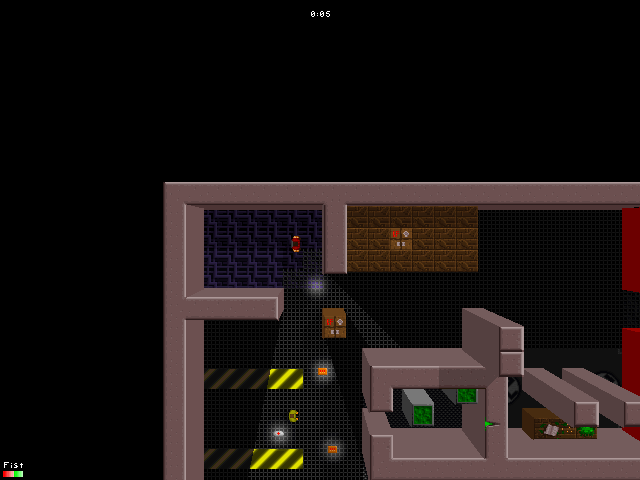

# tk4-web

[](https://github.com/eioo/tk4-web/actions/workflows/ci.yml)

A browser port of **Tapan Kaikki 4: Bloodshed** — a top-down _"kill everything that
moves"_ shooter — rebuilt on **[Bun](https://bun.sh)** with a custom Canvas2D/WebGL
renderer and **no game framework**. The goal is a 1:1 reproduction: the same physics,
draw order, sounds and art as the original C++/SDL 1.2 game.

> ### ▶ [Play in your browser at **tk4.space**](https://tk4.space)



The original source lives in `tapankaikki4/` (a reference checkout of the [upstream
repo](https://github.com/suomipelit/tapankaikki4), not part of this repository's
history). The reverse-engineering notes and the design docs are in
[`docs/`](docs/README.md).

> [!IMPORTANT]
> **This project was built mostly by AI.** The code, tests and documentation were
> produced by an LLM coding agent under human direction and review. It is a
> fan-made hobby project — expect rough edges, and don't treat it as
> production-grade or as a reference implementation. It is a derivative work of the
> original GPLv2 release and is distributed under the same license; see
> [Credits & licensing](#credits--licensing) and [LICENSE](LICENSE).

## Features

- **1:1 simulation** at a fixed 100 Hz tick with a glibc-compatible, seedable
  `rand()`, so a seed reproduces a run byte-for-byte.
- **The full game**: campaign episodes, the shop, statistics, the original menus and
  HUD, and local **split-screen for up to four players**.
- **Online multiplayer** over Bun WebSockets with client-side **prediction + rollback**
  — local movement is instant, remote players catch up within a round trip.
- **Custom renderer**: an 8-bit palette-indexed software framebuffer blitted to a plain
  `<canvas>` (Canvas2D `putImageData`, with an optional WebGL palette-shader path).
- **Parity harness**: standalone C++ oracles plus scripted simulation traces and static
  frames, diffed byte-for-byte/down to the pixel.

## Requirements

- [Bun](https://bun.sh) — package manager, runtime, test runner and bundler.
- That's it for building and running. Parity testing against the C++ oracle additionally
  needs a C++ compiler (`g++`); see [Tooling & Environment](docs/tooling-and-environment.md).

## Quick start

```sh
bun install
bun run dev           # http://localhost:5173/
```

`bun run dev` starts Vite (HMR) and the netplay WebSocket server side by side, and
fetches the game data on first run: it clones `suomipelit/tapankaikki4` into
`tapankaikki4/` and mirrors `tapankaikki4/data` into `public/assets/`. Later runs skip
both; `bun run assets` forces a refresh.

## Production

```sh
bun run start         # ensure assets + type-check + build to dist/, then host it
```

`bun run start` runs `bun run assets:ensure` (which builds `public/assets/` only if it
is missing), then `bun run build` followed by `bun run serve`. The server
(`tools/serve.ts`, built on `Bun.serve`) serves `dist/` with correct MIME types for the
game's custom asset extensions, long-lived caching for Vite's hashed bundles, and an
`index.html` fallback. Port and bind come from `--port`/`--host` (or `PORT`/`HOST`),
defaulting to `0.0.0.0:4173`:

```sh
bun run serve --port 8080 --host 127.0.0.1   # host an existing dist/ without rebuilding
```

`dist/` is a plain static site (`base: "./"`), so it can also be hosted anywhere.

## Online multiplayer

Online play uses a Bun WebSocket server. In development `bun run dev` runs it alongside
Vite, which proxies `/ws` to it, so there is nothing extra to start:

```sh
bun run dev           # http://localhost:5173/ (Vite) + ws://localhost:4174/ws (netplay)
```

In production `tools/serve.ts` serves both the static build **and** `/ws` on the same
origin (no extra port/DNS/TLS). Behind a reverse proxy, make sure the WebSocket
`Upgrade` is passed through (Caddy needs no special config; Cloudflare proxies
WebSockets by default).

**Match flow:** main menu → _start multiplayer game_ → _online multiplayer_ → host
(5-letter code) or join (enter the code). Names come from _Options → Player 1_. The
design is documented under [`docs/multiplayer/`](docs/multiplayer/README.md).

## Scripts

| Command                     | Purpose                                                             |
| --------------------------- | ------------------------------------------------------------------- |
| `bun run dev`               | Ensure assets, then Vite (HMR) + netplay WS server in parallel      |
| `bun run dev:app`           | Vite dev server only (`http://localhost:5173/`)                     |
| `bun run dev:net`           | Netplay WebSocket server only (same as `bun run net`)               |
| `bun run net`               | Standalone netplay WebSocket server (`--port`/`NET_PORT`, 4174)     |
| `bun run build`             | `tsc --noEmit` + `vite build` → `dist/`                             |
| `bun run start`             | Ensure assets, build, then serve `dist/` + `/ws` (production)       |
| `bun run serve`             | Serve an existing `dist/` + `/ws` (`--port`/`--host`, default 4173) |
| `bun run preview`           | Vite's preview server for an existing build                         |
| `bun run assets`            | Rebuild `public/assets` (clones `tapankaikki4/` if missing)         |
| `bun run assets:ensure`     | Build `public/assets` only if it is missing                         |
| `bun test`                  | Unit tests (Bun's runner)                                           |
| `bun run typecheck`         | TypeScript only                                                     |
| `bun run lint` / `lint:fix` | Lint with oxlint                                                    |
| `bun run fmt` / `fmt:check` | Format with oxfmt                                                   |
| `bun run reference`         | Build the standalone C++ oracles (`/tmp/{rotate,render,sim}_gen`)   |
| `bun run parity`            | Rebuild the oracles and diff scenarios + static frames              |
| `bun run perf`              | Time the presentation path against its 60 fps budget                |

`bun run typecheck`, `lint`, `fmt:check`, `test` and `build` run on every push and pull
request via [GitHub Actions](.github/workflows/ci.yml).

## Parity testing

The port is checked against standalone C++ oracles that re-implement the original
subsystems using the original data. `bun run parity` rebuilds those oracles, regenerates
seeded simulation traces and static frames, runs the same inputs through the port and
reports the first differing byte per case (non-zero exit on drift). See
[docs/parity-testing-and-risks.md](docs/parity-testing-and-risks.md).

`?presenter=webgl` selects the WebGL palette-shader presenter; Canvas2D `putImageData`
is the default and either path produces identical output.

## Project layout

```
src/
  app/      application shell, menus, game session, options, shop
  audio/    sound effects and music playback
  core/     loop, timing, glibc RNG, math helpers
  data/     asset decoders (EFP, FNT, PCX, .lev, palette) and data tables
  net/      online multiplayer: protocol, room manager, transport, prediction
  render/   software framebuffer, draw manager, HUD, presenters
  sim/      the 100 Hz simulation: world, entities, physics, replay
tools/      build/serve/net servers, asset pipeline, C++ parity oracles
docs/       reverse-engineering notes, architecture and design docs
```

## Status

Single-player co-op campaign is playable end-to-end at verified parity. Local
split-screen (up to four players) and deathmatch (frags, respawn, kill texts) are in.
Online multiplayer is implemented — the protocol, room manager, Bun servers, the
online menus/lobby, and the match with client-side prediction + rollback so local
movement is instant; cross-machine play still wants a manual pass on real hardware.
See [docs/implementation-plan.md](docs/implementation-plan.md) for the milestone
history and [docs/multiplayer/](docs/multiplayer/README.md) for netplay.

## Credits & licensing

- **Original game:** _Tapan Kaikki 4: Bloodshed_ by the Tapan Kaikki team. The
  reference source is the [suomipelit/tapankaikki4](https://github.com/suomipelit/tapankaikki4)
  open-source release (originally the [SourceForge `tapankaikki` project](https://sourceforge.net/projects/tapankaikki/)),
  licensed **GPL-2.0**. Its engine, levels, sprites, sounds and music are the work of
  their original authors.
- **License:** this port is a **derivative work** of that GPLv2 code — the C++ parity
  oracles under `tools/reference/` are near-verbatim copies and the TypeScript modules
  are direct ports — so it is distributed under the **GNU General Public License,
  version 2 only**: see [LICENSE](LICENSE). As with the original, v2 is the only valid
  version of the GPL for this project (not v2.2 or v3.x). The license text is also
  served with the deployed game at [`/LICENSE.txt`](https://tk4.space/LICENSE.txt).
- **Corresponding source:** this repository,
  <https://github.com/eioo/tk4-web> (GPLv2 §3).
- **Game data:** the original artwork, levels, sounds and music are **not** stored in
  this repository's history. `bun run assets` fetches them from the upstream project at
  build time; the built site then serves them, and they remain under the upstream
  GPLv2 terms and their authors' copyright.
- **No warranty:** the program is provided "as is", without warranty of any kind
  (GPLv2 §11–12).

See [docs/game-overview.md](docs/game-overview.md) for what the game is and
[docs/README.md](docs/README.md) for the full documentation index.
